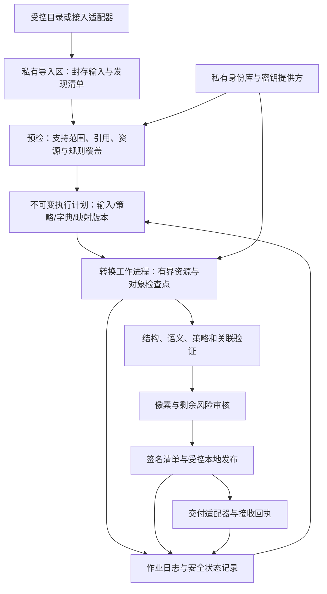

# MedSeal-MBT 企业级深化升级方案

## 当前实施对照（后续升级已落实）

| 阶段 | 当前软件与证据 | 未宣称完成 |
| --- | --- | --- |
| P0 | 发现/路径/故障矩阵、真实进程竞争/强杀及 HFS+ ENOSPC | 全存储系统和断电认证 |
| P1 / W0 / W1 | strict 路径/优先级/条件、120 属性/141 索引、475 固定案例、公共门面和解释 | 完整 IOD/Annex E |
| P2 / W2 | 持久身份/备份/轮换、缓存迁移、历史确认引用、DT 精度与目的地 outbox | 任意远程协议 exactly-once 或自动跨源患者合并 |
| P3 / P4 | 封存/固定运行时恢复及原生像素流式路径，120MiB和10,000对象测量 | 任意大负载恒定 RSS、网络存储/断电认证 |
| P5 / P6 | schema2 审核、Ed25519、独立验签、目录回执和离线安装 | 真实人工证据质量、PACS和临床适用 |
| W3 / W4 / W5 | 限定 CT 体素/HU/几何；状态/故障/fuzz；回环工作台 | 完整 MR/SC Profile、多用户网络服务 |
| W6 | Mooncakes 0.2.0、真实 registry 消费者、GitHub Release 和 GitLink 历史同步 | 旧归档不自动包含后续 master 文档 |
| P7 / W7 | 合成全量+增量+冲突/恢复/签名接收演练，现场证据模板 | 真实来源、接收方、新操作者、独立审查/灾备仍 requires_field |
| 0.5.0 数据处理 | 九个公共包、查询/质量/计划/Native SDK、固定字典 Implicit VR LE | 发行源码；不扩张旧阶段的 IOD/现场认证 |

最新能力见 [支持矩阵](SUPPORT_MATRIX.md)，阶段原始记录见 [W 账本](WINNER_UPGRADE_STATUS.zh-CN.md)，公开发布见 [整改记录](COMPETITION_REMEDIATION.zh-CN.md)。历史核对基线 2c9a49e 当时通过 117 Native / 64×3，共 309 后端执行。当前 0.5.0 本机 Native152 / 其余各99，475固定案例；查询、质量、命名患者计划、Native SDK 与固定字典 Implicit VR LE 已落地，详见[本轮实施账本](DATA_UPGRADE_STATUS.zh-CN.md)。原方案中的代码行号、拟议接口、未完成清单及旧测试数只对应方案制定基线，不能用于描述当前代码。

## 原始设计内容（保留需求与决策背景）


> 当前实施与验收证据见 [企业升级实施记录](ENTERPRISE_STATUS.md)。本文保留方案制定时的基线与目标，拟议版本号不表示已经发布。
> 评估基线：`95629048fd91ca163300c221ec1cac4b88a2fe8e`，0.2.0 候选版，2026-10-10。
> 本文是基于当前源码、测试和已有证据制定的后续计划。除“当前状态”外，新增模块、命令、版本和验收指标均为拟议内容，尚未实现或达成。

## 1. 当前完成到什么程度

**项目已经从单文件字段替换工具，升级为有跨文件一致性检查的 DICOM 元数据批处理引擎；目前属于经过验证的工程原型，尚未达到企业生产交付条件。**

不能用一个“完成百分比”回答成熟度。一个批次能成功转换，与长期处理真实来源、失败后正确恢复、持续导入保持一致、可由别人接手运维，是不同的验收目标。

| 维度 | 当前已完成 | 企业使用仍缺什么 |
| --- | --- | --- |
| 输入解析 | Part 10、Explicit VR Little Endian、支持的 Sequence、ASCII / ISO_IR 6 / ISO_IR 192、有界解析 | 更完整的 VR/VM 语义、按 SOP 的字段约束、真实来源覆盖；其他传输语法和字符集未支持 |
| 元数据转换 | 患者假名、部分直接身份字段清理、私有标签清理、重建 File Meta、清零前导区 | 公共元数据逐类处置、路径与条件规则、可核对的规则来源；目前未知公共非 UI 字段可能保留 |
| 跨文件一致性 | 作业内患者分组、Study/Series/Frame/SOP UID 映射、已支持引用检查、完整 DA 偏移 | 跨作业稳定映射、来源域隔离、增量重复数据处理、更多引用类型、DT/TM 组合语义 |
| 批量处理 | 两遍扫描、输入哈希复核、逐文件转换、私有暂存、输出重解析和目录发布 | 持久化状态、断点恢复、输入不可变副本、系统性故障注入、发布持久性认证 |
| 输出验证 | 支持字段的值/像素字节比较、文件集合与引用检查、DICOM/审计 SHA-256 | 独立语义检查、策略覆盖检查、可信签名、接收方验收、隐私放行决定 |
| 隐私处理 | 公开审计不写原患者值/原路径/映射；明确像素未检查 | 未知字段、自由文本、覆盖层、图形注释、像素文字与面部可识别性等风险的处置流程 |
| 工程验证 | Native 91 项，wasm / wasm-gc / js 各 53 项；已有跨平台 CI | 全资源边界、执行中失败、硬终止、并发目标竞争、真实影像体积、峰值内存、独立标准验证 |
| 交付与运维 | GitHub 分五批推送；文档、示例、CI、候选材料 | 发布安装包、公开包消费者验收、运行手册、备份恢复、密钥管理、现场试点 |

### 当前证据应如何理解

- 本地 HEAD 为 `9562904`，与本地跟踪的 `origin/master` 一致；本轮检查开始时工作区干净。
- 已有最终远程快照记录五次分批 push 完成，最终 CI 在 Linux/macOS/Windows 成功：[对应运行](https://github.com/001-Elsa/MedSeal-MBT/actions/runs/38043238009)。这是已有记录，本轮没有重新查询远端或重跑全套测试。
- 91 + 53 + 53 + 53 是各后端执行结果，共享测试重复运行，不能当作 250 个独立测试场景。
- pydicom 独立检查覆盖 16 / 100 / 1,000 个合成对象。1,000 个对象输入总共约 1.13 MB，记录耗时 1.4334 秒，像素很小；不能据此推算实际医院影像吞吐。
- pydicom 能读回文件，不能证明完整 IOD 或保密 Profile 合规。
- 原深化方案没有全部完成，逐项差距以 [PLAN_AUDIT.md](PLAN_AUDIT.md) 为准。
- 当前记录中 GitLink 新候选版同步和 Mooncakes 0.2.0 发布仍未完成；GitHub 推送不能代替这两项。

现阶段适合在稳定输入、明确支持范围、逐批检查的条件下做开发验证。对于未经检查的真实医疗影像，尚不能依靠当前 `verify` 的成功结果直接对外发放。

## 2. 产品目标：先把一个真实工作流做成熟

建议将产品定位为：**机构内可部署、能够持续导入、保护关联关系、可恢复并提供交付证据的 DICOM 研究数据准备引擎。**

第一条落地工作流：影像数据管理员从已知来源导出研究集合，按项目策略处理；研究人员检查影像可用性；审核人员处置剩余风险；接收方验证交付包；后续追加同一项目数据时保持患者和影像标识一致。

### 首个试点的范围

| 项目 | 首个成熟版本的建议约束 | 为什么 |
| --- | --- | --- |
| 业务 | 机构内部研究、算法开发与数据准备；外部交付需要单独放行 | 可以明确谁对来源、策略和剩余风险负责 |
| 数据 | 已知来源的经典 CT/MR 优先，明确列出扫描设备、导出方式、SOP 和编码 | 当前 Class 名称筛选不等于真实来源兼容；必须按实际语料验收 |
| Secondary Capture | 保留受限处理能力，默认进入像素风险审核 | 截图可能把患者文字烧录到像素中 |
| 运行 | 单机构、单受控数据域、单机工作进程、受支持的本地文件系统 | 先证明恢复和发布正确，再扩展分布式服务 |
| 持续导入 | 同项目同患者保持稳定假名、UID 和日期策略 | 研究集合通常分批形成，现有每次作业新映射无法满足这一点 |
| 数据用途 | 保留经规则批准的成像与空间语义，确保接收方软件可读、可分组、可使用 | 不能为了删字段破坏定量分析、重建或训练所需信息 |
| 第一生产平台 | Linux 本地文件系统先认证；macOS 用于开发与验证；Windows 保持现有 CI | 三平台构建成功不代表三平台恢复、权限和持久性都已认证 |

真实数据的业务许可、来源边界和审核负责人属于试点输入条件。开发阶段继续使用合成样本；现场样本与其原值、映射、截图、异常文件都留在受控环境，不进入公开仓库或 CI 附件。

### 用一个具体例子定义成功

项目 A 分三批导入某患者的 CT：第一批基线检查，第二批随访，第三批重复导出其中一个实例。

成熟版本应做到：前两批使用同一患者假名，已有 Study/Series/实例 UID 不漂移，日期间隔保持规定的语义；完全相同的第三批实例按既定重复策略去重；同一个原 SOP UID 对应不同内容时拒绝并报告冲突。过程中强制终止进程，恢复后映射不变化、不重复偏移、不误发布半成品。交给项目 B 时，除非专门建立经审核的关联流程，否则不复用项目 A 的假名或映射。

研究人员可以用接收工具按患者、检查和序列定位数据；审核人员知道还有哪些像素/元数据风险；接收方能独立确认文件、策略版本、签名和放行证据相互对应。

### 研究可用性必须有具体检查

试点按实际任务列出必须保留的字段及验证方式，例如图像行列、位深、光度解释、像素间距、空间位置/方向、必要的 Rescale 参数与模态参数。只有规则允许保留且输入语义合法时才保留，不以“删除得更多”作为质量指标。

定量 CT 使用者应验证像素值到物理量的转换仍正确；三维分析使用者应验证切片空间关系；纵向研究使用者应验证时间间隔与患者分组；训练管线应验证新数据能稳定导入且重复实例不污染样本计数。私有字段移除影响定量用途时，隔离该来源并设计专门审核规则，不能默默生成“可用”数据。

## 3. 企业级必须满足的行为契约

| 契约 | 可验证的结果 |
| --- | --- |
| 不静默漏数据 | 每个发现的候选文件都记录 accepted / excluded / quarantined / rejected 及原因，计数守恒；默认关键拒绝阻断整个交付 |
| 不静默放宽隐私规则 | 不支持的标签角色、策略条件、编码、SOP 或风险状态必须明确阻断或隔离，不能自动退回 basic 模式 |
| 保持业务关联 | 同项目同来源患者、Study/Series/实例和引用映射一致；跨域身份不能自动合并 |
| 不破坏批准保留的成像语义 | 保留字段和像素达到预先定义的比较标准；外部工具和接收方工作流共同验收 |
| 失败后可解释、可恢复 | 有持久化作业 ID、明确阶段和安全错误码；恢复不会改变已经使用的映射 |
| 不发布半成品 | 转换、验证、必要审核、清单生成和发布按受认证的状态机执行 |
| 结果可以独立核验 | 接收者使用可信公钥核验签名，再核验文件摘要和规定检查，不需要原始患者数据 |
| 运维能接手 | 能安装、检查环境、查看状态、清理暂存、恢复备份、处理密钥不可用和磁盘满 |

“通过结构检查”“执行了元数据策略”“剩余风险已处置”“允许交付”必须是独立状态。任何一个 `valid: true` 或 `conversion: verified` 都不能兼任四者。

## 4. 源码核对后，最先处理的七个问题

| 优先问题 | 当前依据 | 升级动作 | 验收重点 |
| --- | --- | --- | --- |
| 未分类公共字段可能保留 | `src/identity/transform.mbt` 的保留分支；敏感字典是有限表 | 引入标签/路径分类与严格交付策略 | 已知植入的敏感标记不会进入交付包；未覆盖字段明确隔离 |
| `.dcm` 扩展名筛选可能漏对象 | `src/batch/job.mbt` 的 `scan` 忽略其他普通文件 | 有界格式探测、明确输入模式、发现清单与排除理由 | 无扩展名 Part 10 文件进入候选；所有候选有处置记录 |
| 跨批患者与 UID 不稳定 | `src/identity/context.mbt` 在每次 prepare 生成局部映射 | 项目/来源域和持久化映射服务 | 分批、重排、恢复、重试不改变已有映射 |
| 两遍检查不是输入快照 | `job.mbt` / `storage.mbt` 的路径、mtime 和摘要复核 | 受控不可变导入副本、句柄身份检查；限定威胁模型 | 执行中源变化明确失败；后续执行仅使用封存版本 |
| 没有持久化恢复协议 | `Job.consumed`、内存 Context、错误后重新 plan | 作业日志、映射版本绑定、对象检查点、恢复一致性检查 | 每个事务边界强杀后，都只能恢复有效作业或明确隔离 |
| 摘要未认证，策略证据不完整 | `job.mbt` 清单只记录 `research-v1` 名称；`verify.mbt` 使用未签名清单 | 完整策略摘要、标准/字典版本、审核证据摘要、签名封装 | 同时篡改数据与清单仍验签失败；替换策略/审核结论不能沿用放行 |
| 正常路径证据多于故障/负载证据 | `PLAN_AUDIT.md`、`BENCHMARKS.md` | 故障框架、边界矩阵、真实体积负载、独立标准检查 | 磁盘满、并发目标、权限变化、硬终止和大像素均有可重复记录 |

另有两项需要随上述工作一起处理：

1. 单文件 `anonymize` 与批量模式的保证不同，不能让企业工作流误用旧入口。保留兼容能力，但明确标为 basic/兼容路径；新的单对象企业交付也走完整作业机制。
2. 输出暂存文件会包含尚未处置的像素与剩余元数据，不能因为已转换就降低权限。私有暂存、失败样本、映射和现场诊断资料同样属于敏感数据。

## 5. 目标架构与数据边界

采用模块化单体和单机作业模型。MoonBit 保留核心解析、规则执行、身份/引用语义、验证、状态编排；系统权限、事务存储、成熟密码库与网络连接通过窄接口适配。



### 三类存储必须分开

| 区域 | 内容 | 访问与保留 |
| --- | --- | --- |
| 私有输入/身份区 | 原始副本、原路径索引、源摘要、患者/UID 映射、实际日期偏移、审核所需原值 | 仅受授权的作业账户与数据负责人；加密/访问控制/保留期限；不随结果发放 |
| 私有执行区 | 作业日志、检查点、未放行影像、临时文件、故障诊断 | 失败和中断仍保持敏感级别；按作业状态清理；禁止被交付程序直接扫描 |
| 已放行交付区 | 输出 DICOM、值与原路径均不可见的动作审计、公开清单、签名、限定范围的放行结论 | 接收方可验证；禁止混入私有库、原始输入摘要、详细失败样本或临时文件 |

患者假名、UID 和小群体统计仍可能具有关联性。公开审计避免实际日期偏移、原始标识、来源文件名、原路径、原始哈希；内部日志也默认不输出这些内容。身份库不因“存在加密”就允许全体操作者读取。

### 拟新增的内部接口

| 模块 | 职责 | 主要接口方向，非已实现 API |
| --- | --- | --- |
| `src/inventory` | 输入发现、格式探测、处置记录、封存输入描述 | `discover`、`ingest`、`seal` |
| `src/policy/compiler` | 编译规则、检查冲突、生成不可变执行策略 | `compile`、`explain`、`policy_digest` |
| `src/conformance` | 固定字典版本、所选 SOP 与路径的 VR/VM/Type 约束 | `validate_input`、`validate_output` |
| `src/identity/store` | 项目隔离、稳定映射、冲突处理与事务 | `reserve`、`lookup`、`commit` |
| `src/job` | 持久化作业状态、恢复、取消、发布协调 | `create`、`resume`、`status`、`publish` |
| `src/pixel_review` | 风险分类、审核绑定与放行门槛 | `classify`、`record_review`、`gate` |
| `src/attestation` | 规范化清单、签名/验签、可信公钥配置 | `sign`、`verify_signature` |
| `src/connectors` | 与核心解耦的导入和交付协议适配 | `fetch`、`deliver`、`receipt` |

首先拆分现有 `src/batch/job.mbt` 的扫描、计划、执行、发布职责，保持 CLI 和已有库调用通过兼容适配器使用同一核心。避免同时维护 basic、批量、Web 三套转换逻辑。

## 6. DICOM 规则：从有限清理表变成可审查的执行契约

### 6.1 固定标准与字典版本

选定并记录 DICOM PS3.3、PS3.5、PS3.6、PS3.15 的具体版本；规则记录章节/表格、来源和测试。不要用会变化的“current”页面作为唯一可复现依据。

字典扩充使用有许可依据、版本可固定的机器数据源和生成脚本，记录版本与摘要。标准条款由规则说明引用，不把来源不明的第三方实现复制进 MoonBit。独立验证工具的版本和许可也进入 `THIRD_PARTY.md`。

优先完成当前 CT/MR/SC 中受转换影响的字段，再完善所选试点 SOP 的完整输入/输出约束。两者必须分开声明：**所改字段符合约束，不等于整个 IOD 已完整验证。**

Type 1 必须存在且有合法非空值；Type 2 必须存在但可以为空；Type 1C/2C 的条件必须实现并测试，不能只登记一个名称；Type 3 也不能绕过隐私处置。无法可靠求值的条件阻断该 Profile，不能默认为“不适用”。

### 6.2 规则记录结构

每条规则至少包含：

| 字段 | 用途 |
| --- | --- |
| `rule_id`、版本、来源条款 | 可以追踪规则来源和变更 |
| SOP/模块/标签与 Sequence 路径 | 区分相同标签在不同上下文中的语义 |
| VR、VM、Type、条件 | 决定能否清空、删除或替换 |
| 语义角色 | 直接身份、自由文本、日期、实例 UID、标准 UID、像素/图形、结构、成像参数 |
| 动作与优先级 | keep / empty / remove / replace / remap / shift / quarantine |
| 保留理由与剩余风险 | 解释为何保留成像参数或研究必需字段 |
| 正例、反例、测试编号 | 避免只有一份规则说明而无可运行证据 |

### 6.3 编译与覆盖原则

- 内置硬约束优先于项目覆盖规则，例如身份 UID 不能随意 `keep`，像素风险不能被用户规则改成“已检查”。
- 路径匹配明确具体路径与通配规则的关系；同优先级规则冲突在编译阶段报错，不能取决于 JSON 顺序。
- 支持有限、可分析的条件语言，先实现 SOP、标签存在、枚举值和明确的路径范围；不接入任意脚本执行。
- 编译时拒绝结构破坏、Type 1 删除、非法替换值、错误 VM、越权覆盖和未知配置。
- 每个遇到的字段都有处置分类。未知公共字段先隔离/阻断；只有能证明合法且安全的处置才能删除或保留，不能一律删除后破坏对象。
- 私有字段默认移除；如真实定量业务需要保留，必须另建供应商/私有创建者/版本/字段语义的审核规则，不允许整体“保留私有标签”。
- 移除原始数字签名、MAC、原始属性等与修改后对象不再一致或可能携带原值的结构时，遵循相应 SOP 与标准规则；新的交付签名在外部清单层提供，不能冒充原 DICOM 签名。
- `plan` 给出规则覆盖、隔离原因和影响的匿名对象数；详细原值仅可进入专门受控的内部审核界面。
- 输出验证检查所有策略动作的后置条件，同时验证批准保留的成像参数，不只比较“writer 前后相等”。

“覆盖率 100%”只表示**声明支持的规则集合和本次出现的字段都有处置记录**，不是对整个 DICOM 标准或所有隐私风险的证明。

## 7. 跨批身份、日期和引用的落地设计

### 7.1 身份域与稳定映射

身份键升级为机构/来源域、患者 Issuer 语义、原 Patient ID 的明确组合。项目决定映射隔离范围；项目名称字符串不能代替访问控制。

- 不同机构都存在 `PatientID=123` 时，默认是不同来源身份。
- Issuer 缺失时，必须依赖明确配置的来源域；不能把所有缺失 Issuer 的数据跨来源合并。
- 姓名/出生日期冲突先隔离并给出内部冲突记录，禁止自动采用“最后一次看到的值”。
- 同一患者多个来源 ID 的合并只能通过受控关联记录完成，保留理由、版本和影响集合；初期不做基于姓名相似度的自动合并。
- 跨项目默认不同假名、不同实例 UID；需要跨项目关联时建立专门授权的数据流程。

持久化实现优先采用单机事务数据库，例如 SQLite，通过已验证的适配接口使用；首版一名写入者，避免一开始设计分布式身份服务。唯一约束至少覆盖 `(project, source_domain, original_identity_key)` 以及输出 UID，原始键不能明文成为公开索引。

安全查询键可使用成熟库的带密钥摘要；原始身份材料、映射与偏移按需要用认证加密保存。编码必须有版本与长度边界，密钥按用途隔离。**不能用普通 SHA-256 患者号当“不可逆匿名标识”，也不自行实现密码算法。**

患者假名建议采用随机不透明值后持久化。UID 使用符合标准的生成方案、系统熵与数据库唯一性校验，映射一经绑定到交付结果就保持稳定；同项目中同一身份 UID 的主体和引用始终共用一个映射。

密钥提供方首版支持一种经过验证的部署方式；可以是机构已有密钥服务或受控本机密钥机制。避免把明文密钥写进策略 JSON、参数、日志或仓库。KMS 不可用时停止需要密钥的操作，不能回退到明文存储。

密钥轮换区分“加密包装密钥轮换”和“改变映射命名空间”。前者重新保护已有数据但不改变输出标识；后者属于新项目/新映射周期，必须显式迁移与告知，不能静默使历史患者身份漂移。

### 7.2 重复与增量策略

| 情况 | 默认行为 |
| --- | --- |
| 同项目、同 SOP UID、同内容 | 幂等命中已知对象，记录重复，不重新分配标识 |
| 同 SOP UID、不同内容 | 冲突隔离，禁止覆盖已交付对象 |
| 新实例属于已知患者/Study/Series | 复用对应患者与 Study/Series 映射，新建实例映射 |
| 引用本批之外的历史对象 | 从项目登记簿验证历史交付记录；未找到则按受控外部引用策略处置 |
| 来源患者键冲突 | 整批阻断或隔离整个受影响关联分量，不留下断裂引用 |
| 已处理输出再次导入 | 识别处理域与策略，进入显式迁移流程；禁止再次盲目偏移日期 |

原始文件摘要只用于私有侧幂等和溯源，不向接收方公开。若需要识别“同 UID、不同封装但临床内容相同”，必须另定义语义比较契约，首版不能自行推断等价。

### 7.3 日期与引用不能只按字符串替换

- 同项目同患者的日期策略固定并持久化；恢复、增量和密钥包装轮换不重新随机偏移。
- 在现有完整 DA 基础上，按所选 SOP 建立日期/时间字段表；选择移除、保留或偏移的明确业务理由。
- DT 必须处理精度、时区和边界；不完整日期不能补造不存在的月日。DA+TM 组合、跨午夜、闰日、跨年和精度损失分别测试。
- 年龄、出生日期、身高体重等可能影响研究，也可能构成间接识别信息。按研究用途选择移除/分组/保留及放行条件，不能声称日期偏移就消除关联风险。
- 标准 UID、实例 UID、设备 UID 等依上下文分类；不能把所有 UI 都重映射。
- 扩展引用时记录 SOP/路径/UID 角色，检查 Frame、Study/Series、实例引用的所有权与合法语义；现有“同患者”规则仅适用于其声明支持的上下文，不能无条件推广到全部 DICOM 引用结构。
- 删除对象或关联结构可能影响整个关联分量；严格交付默认全作业成功。允许部分交付时必须重新计算闭包、显式列出排除对象和原因，不能简单跳过失败文件。

## 8. 可恢复作业和可靠发布

### 8.1 状态机

拟采用：

```text
CREATED -> INGESTED -> PLANNED -> RUNNING -> VALIDATING
  -> AWAITING_REVIEW -> READY -> PUBLISHING -> PUBLISHED

异常状态：FAILED / CANCELLED / STALE / QUARANTINED
```

`AWAITING_REVIEW` 是否需要人工动作由交付策略决定；即使满足自动放行条件，也必须产生具体的门槛判断记录。各阶段可恢复条件不同，不能只设置一个 `resume=true`。

输入封存后，执行计划绑定输入清单摘要、完整编译策略摘要、字典/标准版本、工具版本、项目、映射代次、资源参数。改变这些条件产生新作业或明确迁移，不继续使用旧计划。

### 8.2 事务顺序

1. 在私有身份库中预留并持久化本作业使用的映射和日期偏移；允许失败作业留下可核对的预留，禁止恢复时另配身份。
2. 写入作业描述与输入封存记录；日志不以原患者值作对象 ID。
3. 每个对象写到临时文件，完成同步、重读验证后，将检查点与摘要提交到作业日志。
4. 崩溃发生在“文件已写，检查点未提交”之间时，恢复先验证文件，再补登记或重做；绝不能只凭文件存在跳过。
5. 全集合验证、风险处置完成后生成不可变公开清单；签名覆盖其规范化字节和审核证据摘要。
6. 在受支持的同一文件系统中进行不覆盖的目录发布，并完成规定的目录/父目录同步。
7. 发布已发生但日志尚未提交时，恢复根据可信作业描述、清单与结果校验补记；发布前失败不能将暂存目录直接标为完成。

数据库与文件系统不是一个原子事务。设计必须显式处理两者之间每个崩溃窗口。恢复协议要可重入、可核验，不能承诺跨两种存储自然具有“恰好一次”语义。

### 8.3 系统边界

- 输入导入到受控私有副本或使用经过验证的快照机制；导入时比较打开句柄身份、变化信息与摘要，确保选定输入集封存完整。
- 消费者只看 `PUBLISHED` 交付区，不扫描暂存区。输出父目录必须受作业账户控制，路径解析与 no-follow / 不覆盖行为采用经过测试的平台适配器。
- 先认证本地文件系统；网络文件系统、对象存储发布和不具备所需同步能力的平台属于后续独立适配，不能沿用本地 rename 结论。
- Unix 0600/0700 不自动等价于 Windows ACL；跨平台权限与持久性必须分别验证。
- 进程权限、路径句柄、父目录链接、硬链接、挂载边界和同目标竞争都有测试。拥有管理员权限并恶意修改底层文件系统不在首版保证范围内，部署约束必须说明。
- “断电后持久”需要实际文件系统/系统层面的证据；进程强杀测试只能证明进程中断恢复。
- 取消与清理按作业所有权执行；禁止删除任意命名相似的目录。过期暂存有状态、期限和可审查的清理结果。
- SSD 上删除文件不能保证物理不可恢复。需要该保证的部署依靠加密、密钥与保留策略，不能把删除命令叫作安全擦除。

## 9. 流式处理、容量与实际兼容性

### 9.1 当前架构的容量问题

现有两遍方案避免同时载入所有完整影像，但每个对象仍先读完整 Bytes、解析，再生成完整输出并重读验证。峰值内存可能包含输入、解析值、输出、验证副本和双份集合元数据；“一次处理一个文件”不能直接推导峰值等于一份文件大小。

`metadata_only` 和估算预算也不等于进程实际内存，文本、数组、原字节缓存、映射与运行时开销都需要测量。

### 9.2 升级方向

- 有界 reader 与事件/索引解析：保留需要变换的元数据结构，大体积未修改二进制值用受控源跨度描述。
- writer 以有界缓冲写入目标，重新计算被改变的长度；保留载荷按跨度复制并增量计算摘要。
- 输入封存是跨度复制的前提，避免解析时的源文件与复制时内容不同。
- 对输出进行独立流式重读；元数据后置条件、引用图和载荷摘要分别验证。
- 首版不为追求并发破坏关联语义。先完成单工作进程资源预算，再加入有限并行和背压；身份预留与全局引用检查仍统一管理。
- 内存、暂存空间、磁盘余量、文件句柄、对象数、UID 数、审核负载和审计大小都纳入资源契约。
- 流式完成后才讨论提高 256 MiB / 128 MiB 限制；不能先移除保护上限。

### 9.3 格式扩展由语料决定

优先统计试点实际存在的 Transfer Syntax、SOP、字符集、厂商私有字段、日期精度、引用路径与文件体积，再选覆盖收益最高的扩展。

可能优先顺序：Implicit VR Little Endian 与严格字典查找；试点使用的封装压缩传输语法的元数据转换与载荷保真；试点所需字符集；必要时 Enhanced CT/MR。每项都单独建立正例、畸形反例、独立读回与语义检查。

压缩载荷原样保留，不代表已经解码验证或检查像素隐私。字符集转码不只是 UTF-8 解码，还涉及继承、多值、PN 组和转义状态；在没有证据前继续拒绝。SR/SEG/RT、封装文档、DICOMDIR、视频等拥有额外语义，不以“解析通过”自动纳入支持。

### 9.4 首个容量验收建议

以下是待实现、待测量的目标；在 P0 取得基准后冻结测试机、文件系统和目标值。目标不是当前承诺。

| 负载 | 用途 | 验收条件 |
| --- | --- | --- |
| 100 / 1,000 / 10,000 对象 | 对象数、引用图和审计增长 | 完成或在预算前明确拒绝；不能静默漏对象 |
| 1 / 16 / 64 / 120 MiB 载荷 | 当前保护范围内的大像素压力 | 载荷摘要相同，资源受控，记录峰值 RSS/空间/耗时 |
| 固定 64 MiB 对象，1,000 与 10,000 对象 | 集合增长是否产生完整文件累计 | 在约定元数据预算内，峰值 RSS 增长由索引/映射预算解释，不能接近总载荷增长 |
| 后续至少 512 MiB 单对象 | 验证流式改造价值 | 仅在声明扩展支持后执行；目标单 worker RSS 不超过 512 MiB，超预算明确失败 |
| 磁盘空间与句柄接近预算 | 验证资源退出和恢复 | 失败不发布，状态明确，恢复/清理可执行 |

正式性能报告区分 ingest、plan、transform、verify、review、publish；至少重复五次报告中位数、范围、数据规模、CPU/磁盘/内存、缓存状态。要报告 p95 时使用至少 20 个同口径样本并注明样本数，不能把五次测量包装成稳定的尾延迟结论。吞吐目标在代表性语料与参考环境测量后确定，不能使用合成小文件单次时间拟合临床 SLA。

## 10. 像素风险与交付审核

成熟版本必须把像素风险放进实际工作流，即便暂不自行实现 OCR 或涂抹。

| 风险 | 建议处置 | 必须保留的证据 |
| --- | --- | --- |
| 烧录文字/截图 | 来源与 SOP 分类、全部受影响帧检查或可信处理流程；Secondary Capture 默认阻断自动放行 | 处理工具版本、帧覆盖、审核结果、最终载荷摘要 |
| Overlay、图形注释、其他隐藏载荷 | 按支持的 Profile 清理或审核；未知结构阻断 | 对应路径规则与验证结果 |
| 可识别面部/身体特征 | 按研究用途采用经验证的处理或限制交付 | 使用条件、处理/审核范围、批准的残余风险 |
| 自由文本和厂商信息 | 默认清理或进入受控审核；筛查模型仅提供线索 | 所用规则、人工决定与对象摘要 |

不能只凭 `BurnedInAnnotation=NO` 或“OCR 没识别到姓名”放行。对多帧数据要说明检查覆盖；少量抽样不能当作全部帧已检查。元数据完全处理也不消除稀有病例或可识别解剖特征的关联风险。

首版实现“风险分类 + 阻断 + 审核绑定”即可形成可信流程；OCR 作为可插拔辅助后续加入，不让模型置信度直接生成“完全匿名”结论。

每条审核记录绑定具体输出文件摘要、策略摘要、处理版本、审核人/角色和决定。文件或策略变化时，旧记录失效并回到审核状态。像素被清理后，原来的“像素保真”证据不再适用，改为记录变更范围、图像质量和下游可用性验证。

公开包只提供必要的放行结论与证据摘要；含患者文字的审核截图、原值和详细发现记录留在私有区域。试点应约定哪些情况必须人工复核、哪些允许经过认证的来源流程自动放行。

## 11. 验证体系：给每条承诺建立独立证据

| 验证层 | 方法 | 关键验收 |
| --- | --- | --- |
| 规则与语义 | 每条规则正/反例，VM/Type/条件边界，真实来源最小复现 | 规则集合全部关联测试；非法数据没有 silent fallback |
| 性质测试 | 重排输入、分批/合批、增量与恢复、随机嵌套、日期边界 | 已有映射不漂移；引用一致；日期间隔满足选定语义 |
| 解析模糊测试 | 长度/截断/嵌套/VR/编码变异，有时限和内存限额 | 不出现越界、非受控崩溃、挂死或无限资源增长；失败样本形成回归 |
| 故障注入 | open/read/write/sync/rename/事务提交/熵源/密钥调用失败 | 状态符合契约、无半成品、可恢复或明确隔离 |
| 硬终止与竞争 | 每个事务边界强杀、同目标双进程、输入与父目录变化 | 一次有效发布或明确失败；无映射漂移、错误覆盖和越权清理 |
| 隐私回归 | 在标签、嵌套、前导区、File Meta、文件名、错误和日志植入唯一合成标记 | 应清理标记在公开输出/报告/日志均不可见；未支持位置触发阻断 |
| 独立标准检查 | pydicom + 另一套与实现独立的 DICOM 验证工具，例如经评估的 dicom3tools/dciodvfy | 所选完整试点 SOP 无未处置错误；warning 分类并有理由 |
| 接收方验证 | 真实目标查看器/研究脚本/系统导入 | 分组、空间与像素可用性满足任务；不能只证明一个 parser 能读 |
| 运维演练 | 安装、备份恢复、密钥不可用、权限变更、空间耗尽、损坏检查点 | 运维按手册可完成，不依赖作者现场改数据库 |
| 负载 | 不同体积/对象数/编码/引用深度，统计重复测量 | 峰值内存与磁盘预算可解释，吞吐报告可复现 |

独立工具输出也可能带患者值，现场验证日志同样受控。外部工具若发现标准错误，应修正实现或缩小支持声明；不能仅为保持 CI 绿色把错误全部忽略。

增加关键分支的变异测试：人为移除 UID 同步、日期偏移、摘要检查、风险阻断或 Type 约束后，相关测试必须失败。覆盖率作为发现空白的工具，不能以某个总百分比代替上述行为验收。

每项证据记录源码 commit、工具/依赖版本、样本生成版本与摘要、平台/文件系统、场景编号、预期/实际、结果和证据位置。安全关键失败没有待解决项时，才允许通过对应里程碑。

## 12. 分阶段执行计划与发布门槛

各阶段按依赖推进；拟议版本是里程碑名称，实际版本号在交付时确定。人力投入按相对规模表达：小为集中补齐与验收，中为新增一个明确模块，大为跨模块协议与现场认证；这不是日期承诺。

### P0：补齐现有候选版的可靠性证据，拟 0.2.1

**目标：先判断当前基础在哪些环境可靠，修正会误导用户或破坏数据的行为。投入：中。**

- 将故障可注入接口加入 `storage` / 批量执行，覆盖执行中源变化、磁盘满、部分写入、同步失败、发布失败、同目标并发、硬终止遗留暂存。
- 系统验证父目录链接、硬链接、大小写别名、权限和目标竞争；平台能力不足时明确拒绝对应部署方式。
- 补资源限值的 `limit-1 / limit / limit+1` 测试，以及当前支持 VR 关键边界；修复测试暴露的问题。
- 输入发现计数、处理/校验状态含义和兼容 basic 模式警示进入 CLI 结果契约；批量结构验证不再被解释为交付许可。
- 测量大像素与 RSS 基准，记录实际当前瓶颈；不预先调大保护上限。

交付：故障测试框架、现有范围缺陷修复、运行环境约束、机器可读基准与 `[现有门槛 -> 测试 -> 结果]` 表。

验收：所有承诺场景可复现；失败不产生被误认为已完成的目标；现有 supported subset 正常路径及 pydicom 对照不退步；未保证的系统行为有明确阻断/边界。

**P0 不新增自动恢复能力，不将强杀后的遗留目录直接发布。**

### P1：策略编译和 DICOM 语义闭环，拟 0.3.0

**目标：转换规则可追踪，未分类信息不能混进严格交付。投入：大。依赖 P0。**

- 新增固定版本字典、规则来源表、路径/有限条件编译器与 `explain`。
- 完成当前变更字段的 VR/VM/Type/条件；按首个试点 SOP 扩大到明确的完整对象约束。
- 处理公共自由文本、隐含原值结构、私有字段与图形/覆盖层；未知结构有隔离行为。
- 每个字段的动作和保留理由可解释，策略摘要进入计划和审计。
- 单对象企业处理复用完整作业引擎；旧 basic 入口仍明确保持其较弱保证。

交付：规则 schema、编译策略、来源/测试追踪表、语义验证模块、严格策略与迁移文档。

验收：声明规则集合全有测试；策略冲突/越权在执行前失败；植入元数据标记不泄漏；完整试点 SOP 经独立工具检查，问题明确处置；成像语义和批准保留字段有接收方验证。

### P2：项目身份库与跨批一致性，拟 0.4.0

**目标：同一研究项目能够持续累积数据。投入：大。依赖 P1；存储/密码适配先做可行性验证。**

- 建立项目、来源域、患者/UID 映射、日期偏移与对象登记簿。
- 接入一种事务存储和成熟密码实现；支持密钥提供、唯一约束、私有备份与完整性校验。
- 增量、重复、冲突、历史引用及处理标记的行为确定；首版禁止自动患者合并。
- 实现最小权限与数据/日志分区；密钥轮换区分包装与映射域变更。

交付：映射库 schema、版本迁移、适配器、备份恢复手册、密钥机制、增量样例。

验收：三批导入例子成立；输入重排、重试和并发预留不改变已有映射；项目隔离；密钥不可用明确失败；备份恢复后已有输出身份完全一致；私有信息不进入公开日志/包。

### P3：持久化作业、恢复与本地可靠发布，拟 0.5.0

**目标：中断或故障之后能安全继续，运维能处理失败。投入：大。依赖 P0、P2。**

- 建立不可变导入副本、执行计划摘要、作业日志、对象检查点和状态机。
- 完成恢复、取消、状态查看、过期暂存清理；映射先预留持久化，再写输出。
- 覆盖文件/数据库不同步、发布/日志不同步的窗口。
- 认证首个平台的 no-replace 发布、同步、目录权限和故障行为；明确其他平台差异。

交付：恢复协议、状态 schema、平台发布适配器、故障矩阵、可操作手册。

验收：各事务边界强杀后可重复恢复或隔离；恢复不改映射、不重复偏移；同目标竞争不覆盖；不依赖手动修改状态；进程中断与断电保证分开记录。

### P4：流式载荷与真实来源覆盖，拟 0.6.0

**目标：处理实际影像体积与导出格式，资源消耗有界。投入：大。依赖 P1、P3。**

- 改造 reader/parser/writer/verify，采用二进制跨度复制、增量摘要和有界缓冲。
- 实测元数据/映射索引开销；设置 worker、磁盘、句柄和并发预算。
- 按试点语料逐项扩展最需要的传输语法、字符集和 SOP，发布更新后的支持矩阵。
- 建立接收方软件验证与不同体积负载报告。

交付：流式执行路径、代表性语料矩阵、资源配置、统计基准、格式扩展证据。

验收：第 9 节冻结的负载门槛达成；大对象不形成完整副本内存叠加；超预算明确拒绝且可恢复；未修改载荷摘要一致；每种新增格式都通过独立检查与接收方验收。

### P5：风险审核和放行门槛，拟 0.7.0

**目标：数据从“转换成功”走到“有依据允许交付”。投入：中至大。风险模型在 P1 就定义，功能可与 P4 交错完成。**

- 实现像素/自由文本/隐藏载荷风险分类、审核状态和输出摘要绑定。
- 初版以可靠阻断和人工/来源流程证据为主；按试点需求加入辅助 OCR 或外部像素处理。
- 保留受控审核资料；公开包仅含必要结论，变更使旧审核失效。
- 研究人员验收图像质量和数据可用性；审核职责与决定可追踪。

交付：风险清单、放行策略、审核记录格式、处理适配接口、人工操作流程。

验收：存在未处置阻断风险的对象无法发布；覆盖多帧/SC/Overlay 等声明场景；OCR 阴性不自动等于安全；审核后改文件/策略必须重新审核；像素改写后的质量证据与保真证据分开。

### P6：可信交付、安装发布与首个系统接入，拟 0.8.0

**目标：接收方能验证，使用者能安装，现场系统能接入。投入：中至大。依赖 P3、P5。**

- 对规范化清单签名，绑定输出、策略/字典/工具版本和放行证据；独立验签客户端只需要可信公钥。
- 增加签名密钥与身份密钥用途隔离、公钥分发/轮换规则。
- 提供固定依赖、可核验安装包、SBOM、许可证说明、离线运行和环境检查。
- 首个连接优先采用受控目录导入/交付与回执；试点确有需要再做 DICOMweb QIDO/WADO/STOW 适配，不同时实现全部 PACS 协议。
- 外部交付使用幂等任务、重试日志、逐对象状态和接收回执；网络部分成功不能当作整体事务成功。

交付：签名包、独立验证工具、安装发布资产、连接适配器、接收回执和排障手册。

验收：同时修改数据与清单仍不能通过可信验签；错误公钥/未知版本失败；从干净环境安装、离线运行和独立包消费成功；连接超时/部分接受后不会误报完整交付。

### P7：现场试点与有限范围生产版本，拟 1.0

**目标：由实际使用者重复完成真实任务并能运维。投入：大，依赖真实合作场景。依赖 P0–P6。**

- 明确试点数据负责人、研究使用者、审核者和运维责任，冻结来源与用途契约。
- 执行首次全量、至少两次增量、一次中断恢复、一次冲突处置和一次备份恢复。
- 使用现场目标工具验证成像可用性，核对候选/排除/交付计数和人工负担。
- 在私有环境记录问题并形成合成回归；公开结果只报告限定范围的指标。
- 发布支持矩阵、已知限制、升级/回滚与恢复手册，完成关键模块独立审查。

交付：试点验收记录、运行指标、生产安装包、值班/交接资料、版本支持政策。

验收：无未处置的数据损坏、身份混并、隐私绕过和半成品发布问题；操作者依手册完成流程；有可复现容量与恢复证据；接收方确认使用价值。缺少现场合作方时，只能达到经过验证的产品候选版，不能凭合成测试宣称生产落地完成。

## 13. 最先落实的提交批次

每批一个可评审的目的、配套验收和文档，保持原项目历史。提交数量取决于实际变更，不为凑次数拆文件。

| 批次 | 工作 | 完成标志 |
| --- | --- | --- |
| 1 | 冻结现有行为、建立输入/输出/失败状态契约和风险测试矩阵 | 当前与拟议保证清楚分开，每个 P0 场景有编号 |
| 2 | 存储故障注入、执行中源变化、同目标竞争与路径别名测试 | 能稳定复现风险；修复有前后对照 |
| 3 | 有界格式发现、候选处置计数、结构成功与交付状态区分、兼容入口说明 | 不按扩展名静默漏对象；无安全降级 |
| 4 | 大像素/RSS/空间基准和资源边界测试，完成 P0 审计 | 基准可复现，已知未认证环境明确列出 |
| 5 | 规则 schema、固定字典、SOP 约束与冲突编译 | 规则来源/测试可追踪，未知字段严格处置 |
| 6 | 私有身份库/密钥适配可行性、稳定映射与增量 | 三批导入和项目隔离验收通过 |
| 7 | 作业日志、封存输入与恢复状态机 | 所有恢复窗口有故障证据 |
| 8 | 流式大载荷与试点必需格式 | 容量指标、载荷与接收方验收通过 |
| 9 | 审核绑定、风险门槛、可信签名与独立验证 | 改文件/策略/证据无法沿用旧放行 |
| 10 | 安装交付、现场接入与试点运维 | 由实际操作者完成全量/增量/恢复任务 |

通常的交付顺序是 P0 → P1 → P2 → P3，之后 P4/P5 按来源需求配合推进，最后 P6/P7。故障框架、标准字典/工具选型、真实语料统计可以在不影响接口冻结的范围内提前准备。

## 14. 拟议的用户操作流程

以下是目标交互，**不是当前可执行命令**。当前命令以 README 为准。

```text
medseal doctor
medseal project init ...
medseal ingest ...
medseal plan --job ... --profile ...
medseal run --job ...
medseal status --job ...
medseal resume --job ...
medseal review --job ...
medseal publish --job ...
medseal verify --trust ...
medseal deliver --job ...
```

用户看到的是“发现多少、排除多少、隔离多少、为什么未能交付、如何修复”，而不是底层存储异常。JSON 输出固定 schema；错误输出与结果输出分开，退出码区分配置错误、输入不支持、身份冲突、资源不足、可恢复中断、未放行、完整性/签名失败。

恢复只需作业 ID 和受控工作目录，不要求用户手工找临时文件。`doctor` 检查版本、目录权限、受支持文件系统、密钥提供方、空间与资源；不打印密钥或患者信息。

Web 后台只在多角色审核确实需要时增加，使用同一作业与策略核心。若变成多用户联网服务，再补机构身份接入、角色授权、租户隔离、接口限流与部署安全；这些不是离线单机工具天然具备的能力。

## 15. 运维与治理的最小交付集合

- **安装与升级**：校验发行物、记录工具链/依赖、数据库迁移前备份；升级不改变既有身份映射。版本回滚必须验证数据库兼容，不承诺任意二进制降级可用。
- **备份与恢复**：联合备份身份库、映射版本、密钥引用/恢复机制、作业日志和必要的未完成输入；在隔离环境演练恢复，保证已发布映射不漂移。未备份映射状态的作业不得交付。试点前明确最大允许丢失的私有状态（RPO）与恢复用时（RTO），结合部署和数据体积实测；进程恢复成功不等于主机/磁盘损坏后也满足灾难恢复目标。
- **日志与指标**：匿名 job/object ID、阶段耗时、计数、内存/空间、恢复与失败类别；默认不收集外部遥测。指标标签不能包含患者号、原 UID、源路径或高基数隐私值。
- **清理与留存**：按状态和保留策略清理；失败样本保持受控；已完成作业的删除对历史映射、研究重复性和审计有什么影响要明确。
- **故障处理**：密钥不可用、磁盘满、损坏检查点、输入冲突、未知编码/标签、无法验签各有操作手册；“跳过错误继续发布”不是通用排障方案。
- **漏洞与供应链**：关键依赖与 CI Action 固定可信版本/commit，记录 SBOM 和许可；维护私有漏洞报告渠道与修复回归。已有声明要随支持版本更新。
- **职责**：业务方定义用途与风险承受，数据负责人确认来源，研究使用者验收可用性，审核者作放行决定，运维负责环境与恢复，作者维护技术契约。一个人可以承担多角色，但责任和记录仍要明确。

企业试点最缺的可能是代表性数据、实际接收系统与专业审核，而非更多代码。密码适配、存储恢复、DICOM 语义与像素风险需要针对性独立审查，不把全部审查责任交给同一批实现代码的自动化测试。

## 16. 最终成熟度分级与退出条件

| 等级 | 含义 | MedSeal-MBT 的位置/门槛 |
| --- | --- | --- |
| 工程原型 | 核心链路可运行，有测试与明确范围 | 当前已达到 |
| 受控批处理产品候选 | 严格规则、故障行为和跨批身份一致，能够恢复 | P0–P3 达标后，仍需逐项说明剩余风险 |
| 可交付的企业产品候选 | 代表性负载、风险门槛、签名、安装与接收方验证 | P4–P6 达标后 |
| 限定范围企业生产版本 | 现场重复使用、运维恢复、职责与支持契约完成 | P7 达标后；范围只覆盖已认证来源/格式/用途 |

1.0 不是“任意 DICOM、任意医院、自动完全匿名”的承诺。它应该是一个支持范围可查、输入失败可处理、结果可核验、真实用户能重复完成任务的版本。

本轮只制定并保存上述计划，没有把拟议能力算进当前完成状态，也没有重写核心代码。下一步最有价值的实施工作是 **P0：故障与边界验收、输入处置和真实体积基准**；由这些结果确认缺陷、平台保证和 P1 的接口，而后逐批推进。

### 最小验收场景清单

所有条目为后续待验收项；同一场景需要注明平台、策略和支持范围。出现超出范围的输入时，正确拒绝也可以是预期结果，但必须有明确处置记录。

| 编号 | 输入或操作 | 必须观察到的行为 | 阶段 |
| --- | --- | --- | --- |
| E01 | `.dcm`、无扩展名 Part 10、普通非 DICOM 文件混在目录 | 所有普通文件被发现；分类、排除理由和计数可核对，无扩展名对象不静默遗漏 | P0 |
| E02 | 执行到第 N 个对象时改变未封存源文件或令读取/写入失败 | 当前保证内明确失败，无完成目标；封存机制完成后只消费封存对象 | P0 / P3 |
| E03 | 两个进程同时发布到同一目标；父目录/目标路径被替换 | 至多一个合法发布，无覆盖/写出受控目录；不支持环境明确拒绝 | P0 / P3 |
| E04 | 每个资源限值前后、无熵源、空间不足、权限变化 | 错误可分类、资源有界、无半成品、清理不越权 | P0 |
| E05 | 自由文本、嵌套路径、原始属性、私有字段植入唯一合成标记 | 应清理标记不进入公开包；不支持结构阻断或隔离 | P1 |
| E06 | Type 1 删除、Type 2 缺失、未知条件、错误 VM、冲突规则 | 编译/预检/输出验证按契约失败，无任意 fallback | P1 |
| E07 | 同项目三批导入、重排、重复与新随访 | 已有患者/UID/日期偏移一致，重复按契约去重，新增关联可解析 | P2 |
| E08 | 两个来源患者号相同、跨项目导入、同 SOP UID 不同内容 | 来源/项目隔离；内容冲突阻断，不自动混并 | P2 |
| E09 | 包装密钥轮换、密钥不可用、从备份恢复 | 既有映射不漂移；无密钥不降级；恢复状态可核对 | P2 / P7 |
| E10 | 在映射提交、文件同步、检查点、rename、发布日志之间强杀 | 恢复可重入，身份不变、不二次偏移；有效输出重验，无盲跳过 | P3 |
| E11 | 1,000 / 10,000 对象与大载荷负载 | 达到冻结资源门槛或提前拒绝；RSS/磁盘/耗时证据完整 | P4 |
| E12 | 新传输语法/字符集/引用结构及其畸形版本 | 逐类读回与语义验证；未支持类别无猜测解析 | P4 |
| E13 | SC、多帧、Overlay 或未处置风险 | 未满足门槛无法发布，审核覆盖和输出摘要有绑定 | P5 |
| E14 | 审核后改文件/策略；同时篡改数据与公开清单 | 旧审核失效；可信验签失败，接收方明确拒绝 | P5 / P6 |
| E15 | 连接中断、远端只接收部分对象、回执丢失 | 记录逐对象交付；幂等重试或核对；不得报整体已成功 | P6 |
| E16 | 新操作者干净安装，按手册完成全量/增量/恢复 | 不依赖作者修补现场，接收方确认分组、空间、时间和成像用途可用 | P7 |

## 17. 基线证据与参考入口

- [原深化方案](ITERATION_PLAN.md)、[逐项核对](PLAN_AUDIT.md)、[当前进度](ITERATION_STATUS.md)。
- [当前支持矩阵](SUPPORT_MATRIX.md)、[当前策略](POLICY.md)、[架构](../ARCHITECTURE.md)。
- [本地验证记录](evidence/local-verification.json)、[源码提交与 CI 记录](evidence/github-verification.json)、[性能范围说明](../BENCHMARKS.md)。
- 工作区最终五批推送/文档提交 CI 记录：`../../research/MedSeal深化/push-stages/github-final-verification.json`，它是本地补充证据，不是仓库内公开文件。
- [安全边界](../SECURITY.md)、[第三方与数据来源](../THIRD_PARTY.md)。
- 标准入口：[DICOM 标准](https://www.dicomstandard.org/current)、[PS3.15 Annex E](https://dicom.nema.org/medical/dicom/current/output/chtml/part15/chapter_E.html)。实施时另记录固定版本；本轮未开展标准条文的完整逐项合规审计。

> 文档核对：本文保留固定历史基线；当前实施差异与适用边界已补充核对。见[文档账本](DOCUMENTATION_STATUS.zh-CN.md)；正式申报由韩桢本人完成。
